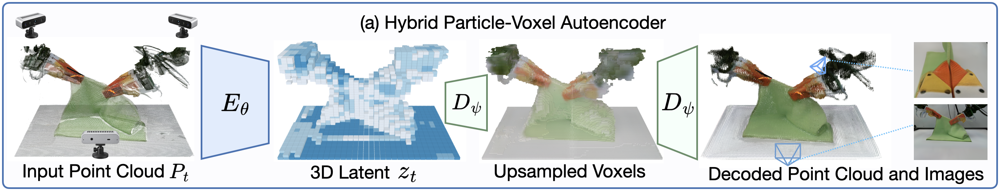
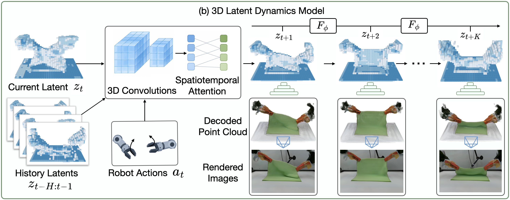

**论文：** Hybrid Particle-Voxel Dynamics for Multimodal 3D World Simulation  
**作者：** Jimmy Wang et al.  
**发表：** arXiv，2026.11  
**论文：** https://arxiv.org/abs/2611.04492  
**项目：** https://jwang771.github.io/3dworldsimulator/  
**代码：** https://github.com/jwang771/3d-world-simulator

**精读进度：** ① 动机 ✓ · ② 架构 ✓ · ③ 训练 ✓ · ④ 数据 ✓ · ⑤ 信息流 ✓ · ⑥ 数字案例待完成

---

## 一、研究动机：为什么需要三维世界模型？

### 1.1 论文要解决什么？

传统视频世界模型通常预测未来 RGB 图像，但是不同视角之间可能存在三维几何不一致的问题。

3D World Simulator 希望直接预测统一的三维场景，然后根据这一场景生成不同视角的图像、点云和触觉信息。

**输入：历史三维状态 + 机器人动作。**

**输出：未来三维状态，并可解码为三维粒子、RGB-D 图像及触觉观测。**

### Figure 1 · 整体任务与应用

[查看原论文 Figure 1（PDF 首页）](https://jwang771.github.io/3dworldsimulator/paper.pdf#page=1)

**读图重点：**

- **中央：** Action-conditioned 3D World Simulation，表示机器人动作条件下的三维世界预测。
- **左上：** 从同一预测三维状态渲染不同视角的 RGB-D 图像。
- **左下：** 预测与三维位置对齐的触觉信息。
- **右侧：** Cloth Folding、Part Assembly、Box Packing、Rope Threading、T Pushing、Marker Insertion 六种操作任务。

**一句话：作者希望一个三维预测状态能够同时服务于几何、视觉和触觉，而不是分别预测互不关联的二维画面。**

### 1.2 为什么使用 Particle + Voxel？

| 表示 | 优势 | 不足 |
|---|---|---|
| Particle | 适合恢复精细、连续的三维几何 | 普通无序点云缺少跨帧点身份对应 |
| Voxel | 固定空间网格，有利于时序预测 | 分辨率不足会损失细节 |
| Voxel Latent | 结构稳定，方便压缩和动力学建模 | 压缩过强可能丢失关键几何 |

核心思想：

**Particle 负责精细几何，Voxel Latent 负责稳定的三维动态预测。**

Voxel 的优势不是天然比点云计算量低，而是其固定空间位置提供了更稳定的预测目标。

---

## 二、模型架构（Architecture）

这是论文最重要的部分，建议复习时优先看 Figure 2。

### 2.1 Figure 2(a) · Hybrid Particle-Voxel Autoencoder

<figure class="paper-figure"></figure>

*图片来源：原论文 Figure 2(a)，作者官方项目页面。*

**从左到右读图：**

1. **Input Point Cloud $P_t$**：输入三维点云。
2. **Encoder $E_\theta$**：通过体素化和 Sparse 3D Convolution 压缩。
3. **3D Latent $z_t$**：得到具有三维空间结构的 Voxel Latent。
4. **Voxel Upsampling**：逐级上采样恢复更细的体素。
5. **Particle Decoder**：在连续三维空间中生成粒子。
6. **Rendered Images**：利用 3D Gaussian 参数渲染多视角图像。

#### 输入点云

论文定义：

$$
P_t\in\mathbb{R}^{7\times N}
$$

每个点包含：

- XYZ：三维坐标。
- RGB：颜色。
- Tactile：触觉通道。

#### Voxel Latent

ALOHA 配置：

$$
z_t\in\mathbb{R}^{32\times16\times32\times8}
$$

前三个维度表示空间网格数量，最后的 8 表示每个体素的特征维度。

因此共有 16,384 个空间位置，每个位置有一个 8 维特征向量。

这些特征是 Encoder 学出来的，不是预先定义的物理属性。

#### Decoder 为什么要恢复 Particle？

低分辨率 Voxel Latent 不足以直接表达精细的毛巾边缘和褶皱，因此 Decoder 先恢复更细的占据体素，再生成连续粒子。

视觉粒子携带 3D Gaussian 参数，可以从不同视角渲染 RGB-D 图像；有触觉监督时，也可以生成空间对齐的触觉粒子。

**记忆：Encoder 学会压缩世界，Decoder 学会恢复世界。**

### 2.2 Figure 2(b) · 3D Latent Dynamics Model

<figure class="paper-figure"></figure>

*图片来源：原论文 Figure 2(b)，作者官方项目页面。*

**从左到右读图：**

1. **Current Latent $z_t$**：当前三维场景的隐空间。
2. **History Latents**：过去多个时刻的隐空间。
3. **Robot Actions**：机器人动作条件。
4. **3D Convolutions**：融合空间特征并降低空间分辨率。
5. **Spatiotemporal Attention**：学习空间关系和时间变化。
6. **未来 Latent**：预测 $z_{t+1},z_{t+2},\ldots$。
7. **Decoded Point Cloud / Rendered Images**：解码生成三维场景及视觉观测。

核心公式：

$$
\hat z_{t+1}=F_\phi(z_{t-H:t},a_t)
$$

**Dynamics Model 预测的是未来 Voxel Latent，而不是直接预测 RGB 视频。**

### 2.3 为什么要进行空间下采样？

以论文 ALOHA 配置中的空间尺寸为例：

`32×16×32 → 16×8×16 → 8×4×8`

空间位置数量：

`16,384 → 2,048 → 256`

随着空间尺寸降低，特征通道数通常增加。

这意味着模型从高空间分辨率、低维特征，逐渐变成低空间分辨率、高维特征。

**两次空间下采样不等于只有两个卷积层。**

论文中的空间下采样与公开 CoarseDynamics3D 代码的具体配置存在差异；公开代码还包含多级卷积块、池化和上采样。

### 2.4 Attention 的作用

| 类型 | 作用 |
|---|---|
| Spatial Attention | 同一帧中不同空间位置的信息交互 |
| Temporal Attention | 不同时间的空间特征交互 |

Spatial Attention 可以帮助模型理解毛巾局部变化如何影响其他区域。

Temporal Attention 可以帮助模型理解某个空间位置随时间发生的变化。

论文总体架构使用时空 Attention；此前查看的公开 CoarseDynamics3D 实现显式使用 Temporal Attention，而空间关系主要通过 3D Convolution 处理。

---

## 三、训练方法与 Loss

### 3.1 两个主要训练阶段

**第一阶段：Autoencoder Training**

学习如何从点云编码出 Voxel Latent，再恢复高质量三维场景。

**第二阶段：Dynamics Training**

固定已经训练好的 Autoencoder，将真实三维序列编码为 Latent 序列，训练模型预测未来状态。

中间的 `export_latents.py` 属于数据准备，而不是独立模型训练阶段。

### 3.2 Autoencoder 的四个 Loss

| Loss | 作用 |
|---|---|
| Voxel Loss | 监督体素占据和相关特征重建 |
| Particle Loss | 监督三维粒子几何与属性 |
| Render Loss | 监督渲染 RGB-D 结果 |
| Consistency Loss | 约束同一场景不同采样的 Latent 一致性 |

#### Consistency Loss

同一个场景产生不同点云采样：

`P_A → Encoder → Z_A`

`P_B → Encoder → Z_B`

希望：

$$
Z_A\approx Z_B
$$

原论文通过同一场景不同点云采样构造一致性监督。

它的主要意义是减弱点云采样变化对 Latent 的影响，使后续 Dynamics Model 更容易学习实际状态变化。

但不能要求所有不同场景都编码成相同的 Latent，否则可能发生 Representation Collapse。

### 3.3 Dynamics Loss

根据真实历史和动作预测未来：

$$
\hat z_{t+1}=F_\phi(z_{\mathrm{history}},a_t)
$$

然后与真实未来 $z_{t+1}$ 比较。

主要使用未来 Latent 的加权预测误差，并在多步预测中对不同时间步进行折扣。

论文使用时间折扣系数 $\gamma=0.95$。

### 3.4 Autoregressive Training

训练时不能总依靠真实历史状态，否则推理时输入自身预测，可能出现 Exposure Bias。

因此模型在训练时：

1. 根据真实历史预测下一帧。
2. 计算 Loss。
3. 把预测的 Latent 加入历史。
4. 输入下一时刻的动作。
5. 继续预测并计算新的 Loss。

官方代码使用 `pred.detach()` 更新历史，避免后续损失通过这条路径跨时间步反传。

### 3.5 Gaussian Noise Augmentation

训练时对历史 Latent 添加高斯噪声：

$$
\tilde z_t=z_t+\epsilon,\qquad
\epsilon\sim\mathcal N(0,\sigma^2I)
$$

作用是让模型适应不准确的历史输入，增强鲁棒性，并缓解长期预测中的误差累积。

**这里加入高斯噪声，并不意味着使用 Diffusion。**

论文 Dynamics Model 直接预测未来 Latent，没有采用 Flow Matching 或多步扩散去噪。

---

## 四、训练数据（Dataset）

### 4.1 数据来源

论文包含六种 ALOHA 机器人任务，并在 Deform360 等多物体数据上进行实验。

原始数据通常包含：

- RGB 和 Depth 图像。
- 相机内参和外参。
- 机器人动作。
- 有效像素与过滤掩码。
- 可选的触觉数据。

多相机 RGB-D 观测通过相机参数反投影和坐标变换，构成统一世界坐标系中的点云。

### 4.2 ALOHA 动作

动作张量：

`(T, 14)`

左右两条机械臂分别提供 7 维：

- 3 维位置。
- 3 维旋转。
- 1 维夹爪状态。

机器人动作是 Dynamics Model 的条件输入，而不是由 Dynamics Model 自己生成。

### 4.3 两个模型需要的数据不同

Autoencoder 可以使用单帧点云进行三维表示学习。

Dynamics Model 则需要时间连续的真实状态序列和对应机器人动作。

因此，只有静态点云可以训练重建模型，却不足以学习动作条件下的动态变化。

---

## 五、输入输出信息流

### 5.1 张量结构

以 Channel-first 的 PyTorch 格式为例：

`z_hist.shape = (B, T, 8, 32, 16, 32)`

其中：

- B：Batch Size。
- T：历史帧数。
- 8：Voxel Latent 通道数。
- 32、16、32：三维空间分辨率。

动作：

`actions.shape = (B, T, 14)`

### 5.2 连续两轮预测

假设历史窗口为 8 帧。

**第一次：**

输入 `Z0–Z7` 与对应动作条件。

输出 `Z8_hat`。

与真实 `Z8` 计算 Loss。

**第二次：**

输入 `Z1–Z7` 和 `Z8_hat`，再提供下一时刻动作。

输出 `Z9_hat`。

与真实 `Z9` 计算 Loss。

之后重复这个过程。

### 5.3 为什么不需要每次重新解码？

因为 Dynamics Model 的输入和输出都是 Voxel Latent。

只需：

`预测 Latent → 更新历史 → 再预测`

不需要每一步都执行：

`Latent → Particle → Encoder → Latent`

只有需要三维几何、视觉观测或外部 Policy 输入时，才需要 Decoder。

### 5.4 动作来源

训练时来自机器人演示轨迹；开环预测时来自预先记录的动作序列；闭环交互时则可以由 Policy 或 Planner 提供。

**Policy 负责选择动作，World Model 负责预测动作产生的结果。**

---

## 六、实验结果与原论文图示

这一节作为后续第七站实验分析的复习入口。

### Figure 3 · 多视角预测对比

[查看原论文 Figure 3（PDF）](https://jwang771.github.io/3dworldsimulator/paper.pdf)

**读图重点：** 比较 Part Assembly 和 Cloth Folding 在 Front、Top、Wrist 不同视角下的预测。

重点观察作者方法与 4DGen、IWS、Cosmos 在长序列预测中出现的多视角不一致、视觉形变和结构错误。

### Figure 4 · 三维点云预测对比

[查看原论文 Figure 4（PDF）](https://jwang771.github.io/3dworldsimulator/paper.pdf)

**读图重点：** 比较 Marker Insertion、Rope Threading、T Pushing 的预测点云与真实点云。

这一张与你关注的 Flying Points 问题最相关。

重点观察离群点、几何结构偏移、缺失区域，以及长时间自回归预测造成的误差。

### Figure 6 · 用世界模型生成数据训练机器人策略

[查看原论文 Figure 6（PDF）](https://jwang771.github.io/3dworldsimulator/paper.pdf)

**读图重点：** 比较使用真实世界数据与世界模型生成数据训练策略，最后在真实机器人上的任务成功率。

### Figure 7 · 仿真与真实世界的策略评估相关性

[查看原论文 Figure 7（PDF）](https://jwang771.github.io/3dworldsimulator/paper.pdf)

**读图重点：** 横轴为真实世界成功率，纵轴为世界模型中的成功率。

论文也包含 π0.5 等 Policy 的评估结果。

这张图的意义是判断世界模型能否成为真实机器人策略评估的代理环境。

### Figure 8 · 未见物体的模型规划

[查看原论文 Figure 8（PDF）](https://jwang771.github.io/3dworldsimulator/paper.pdf)

**读图重点：** Initial State、Planning、Final State 和 Target。

用于理解作者如何将世界模型用于未见物体的规划任务。

---

## 七、关键知识复习

**Q1：为什么选 Voxel？**

因为固定空间网格让未来状态预测具有稳定的空间对应目标。

**Q2：为什么还需要 Particle？**

因为模型需要恢复高质量连续三维几何。

**Q3：为什么分两个主要阶段训练？**

先学会表示和重建世界，再学习世界如何随动作变化。

**Q4：Consistency Loss 为什么重要？**

同一场景的不同点云采样不应该产生剧烈变化的 Latent。

**Q5：为什么使用多步自回归训练？**

因为实际推理时会持续使用自身预测作为历史状态。

**Q6：为什么添加高斯噪声？**

提高对不准确历史输入的鲁棒性。

**Q7：为什么下一帧预测还需要动作？**

相同状态下，不同动作会产生不同的未来。

**Q8：Dynamics Model 使用 Flow Matching 吗？**

原论文不使用，主要采用直接的下一状态 Latent 预测。

**理解测试累计：34/37。**

---

## 八、我的研究设想（简记）

**1. 自适应 Voxel 与多尺度 Latent**

尝试使用粗体素描述整体运动，在接触、折叠及不确定性较高的区域保留精细特征，降低计算量。

**2. VGGT 置信度与 Consistency Loss**

利用同一张图像在不同置信度筛选下产生的点云训练 Encoder，提高三维表示对点云质量差异的鲁棒性。

**3. 抗飞点 Reconstruction Loss**

向输入点云加入飞点等扰动，使用干净几何作为重建监督，探索 Quality-aware Reconstruction Loss，减少飞点对隐空间的影响。

**4. 自生成历史训练**

借鉴 π0.5 讨论中的 Teacher Forcing 与 Scheduled Sampling 思路，研究模型使用自身预测作为历史输入时的长期稳定性。

**5. Flow Matching 后训练**

在已有 Dynamics Model 基础上尝试 Flow Matching，用于未来 Voxel Latent 生成或残差修正，评估预测质量与额外推理成本。

**总体目标：** 探索一种计算效率更高、抗飞点能力更强、长期动态预测更稳定的三维世界模型。

*上述内容均为待验证的研究设想，并非原论文已实现的模块或已证实的创新。*
