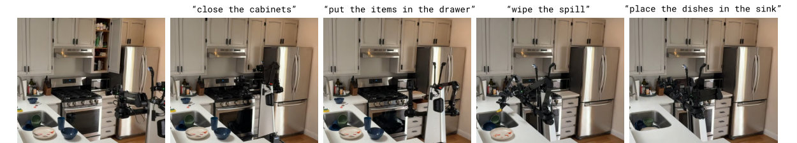
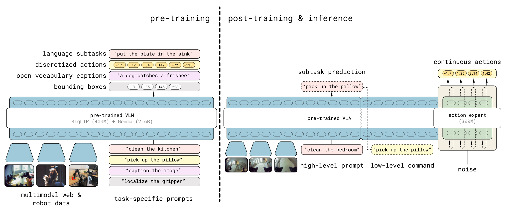
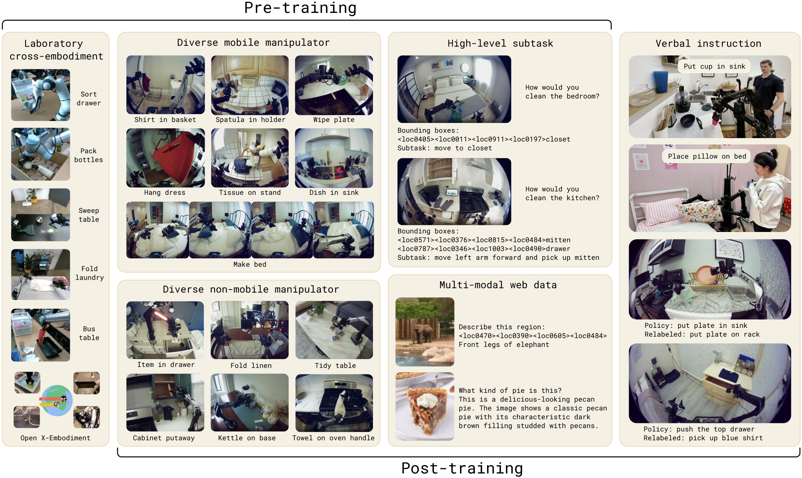
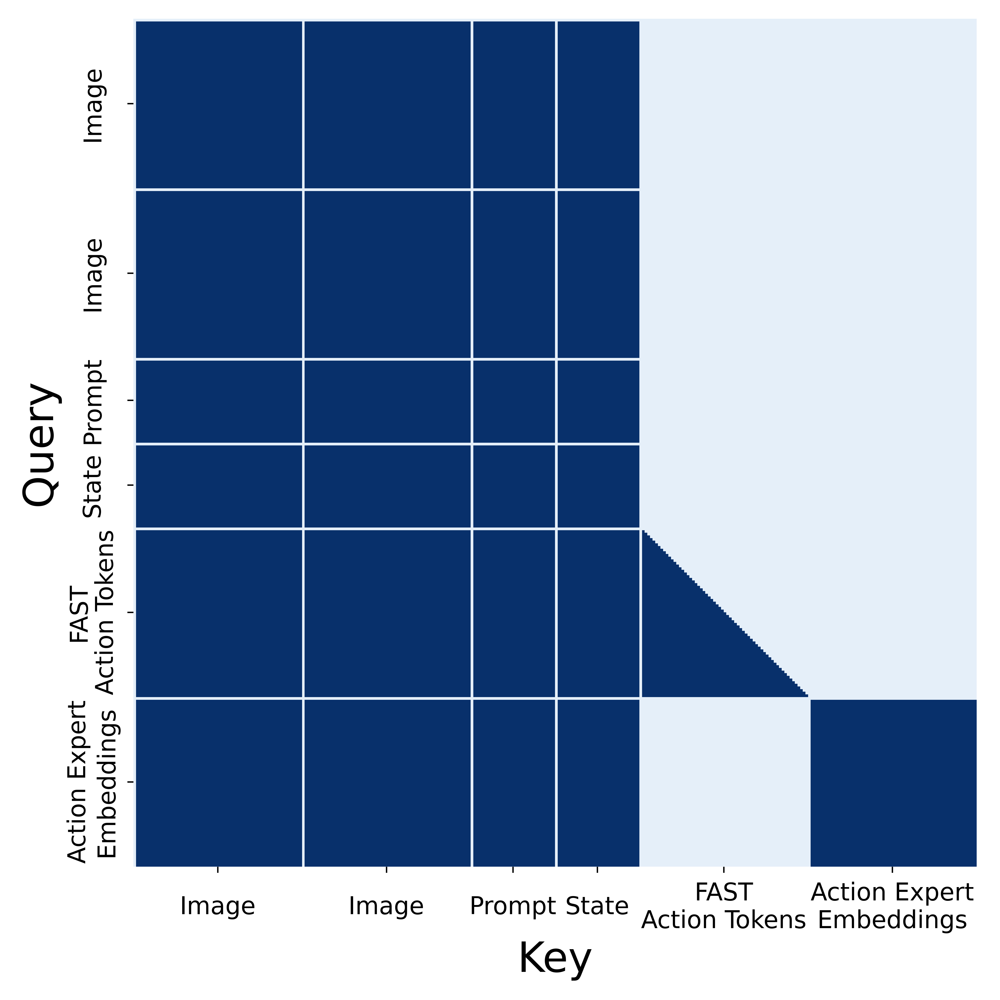
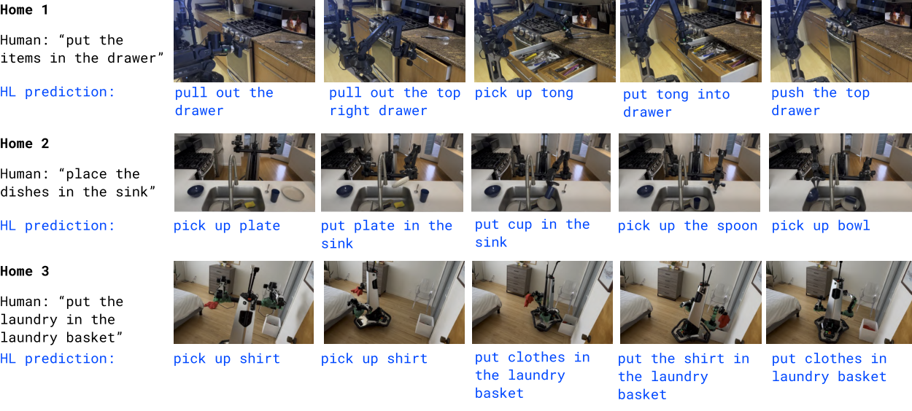

> 按 kelip-paper-reading 的六站路线整理：动机 → 架构 → 训练 → 数据 → 信息流 → 两轮闭环实例。
> 整理与公开实现核对日期：2026-11-11。论文以 arXiv:2504.16054 v1 为准；代码为当日读取的 openpi main，未固定 commit，不能视为永久不变的接口。
> 来源范围：原聊天接口返回的是测试及整理阶段记录，没有返回更早的六站逐字对话。因此本文是根据可见聊天、用户列出的主题与原始资料重新整理的完整复习笔记，不声称逐字还原未取回的内容。

## 阅读约定与导航

- **【论文】**：π0.5 正文、附录明确描述的设计或实验观察。
- **【实现】**：本次核对的 openpi 公开代码；不等于论文完整训练流水线。
- **【示意】**：为理解而设的数字、机器人通道布局、控制频率或简化模型。
- **【推导】**：由公式或掩码推出的解释，不能冒充额外实验结论。

核心公式使用数学排版；信息流与张量形状保留等宽文本，便于对照复习。文中 t 表示机器人控制轮次，τ 表示 Flow Matching 的噪声时间，两者不能混用。

快速路线：先读第 1–2 站建立整体模型，再读第 3 站公式；第 4 站确定数据长相；第 5 站理解 Mask 与 Cache；第 6 站把所有内容串起来。最后用纠错表和自测检查。

## ① 动机：为什么需要 π0.5？

<figure class="paper-figure"><a href="/assets/pi05/fig2.png" target="_blank" rel="noopener"></a><figcaption>图 2｜未见过的厨房中的任务执行。高层子任务与低层动作配合完成操作。 <a href="https://arxiv.org/html/2504.16054v1">来源：π0.5 论文 v1</a> · 点击查看原图</figcaption></figure>


### 要解决的具体问题

【论文】π0.5（Physical Intelligence，2025）面向开放世界中的机器人操作：机器人进入训练时没见过的家庭，仍能按照指令完成整理厨房、收拾卧室等长任务。输入包括视觉、语言和机器人本体状态，输出最终落到连续机器人动作。

难点不只是“认出杯子”：机器人还需要选下一项子任务、适应新的物体布局，并把语义目标转换成可执行的动作。

### 核心思路

【论文】用异构数据共同训练（co-training），把其他机器人、不同环境、视觉语言任务和高层语义监督的知识汇入同一个 VLA。运行时先推断语义子任务，再根据子任务产生低层动作块。论文的泛化证据来自其家庭任务实验及消融，不意味着任意环境、任意指令都已解决。

【示意】“收拾桌面” → “拿起杯子” → 产生接近与抓取动作 → 看到杯子已拿起 → “把杯子放到水槽”。高层选择做什么，低层决定怎样移动。

**一句话复述：π0.5 的核心是异构共同训练和语义—动作结合，不只是把一个动作头接到 VLM 后面。**

来源：[π0.5 正文与图 3](https://arxiv.org/html/2504.16054v1)。

## ② 架构：VLM、FAST 与 Action Expert 分别干什么？

<figure class="paper-figure"><a href="/assets/pi05/fig3.png" target="_blank" rel="noopener"></a><figcaption>图 3｜模型总览：异构数据预训练、后训练与高低层推理。 <a href="https://arxiv.org/html/2504.16054v1">来源：π0.5 论文 v1</a> · 点击查看原图</figcaption></figure>


### 模块地图

| 模块 | 输入 → 输出 | 作用与来源 |
|---|---|---|
| SigLIP 视觉编码器 | 图像 → 视觉 token | PaliGemma 视觉部分，提供视觉表征 |
| Gemma 语言骨干 | 视觉、文本、状态表示 → 上下文表征或离散输出 | 承接预训练 VLM 的语义能力 |
| FAST tokenizer | 连续动作块 → 离散 token；也可逆向解码 | 动作表示方法，不是额外负责看图决策的网络 |
| 离散预测分支 | 上下文与先前 token → 下一 token 分布 | 支持语言、语义标签和离散动作监督 |
| Action Expert | 带噪动作、τ、前缀信息 → 动作速度场 | 较小 Transformer，支持迭代生成连续动作 |

【论文】VLM 与 Expert 通过 Attention 交换信息；不是先把 VLM 的最后一个向量取出来，再交给完全独立的 MLP。后训练引入动作专家；不能据此断言 VLM 必然全部冻结。

### FAST：DCT → 量化 → BPE

【原始 FAST 方法】对每个动作维度沿时间轴做 DCT，再量化、序列化，并用 BPE 压缩离散序列。解码按相反顺序恢复动作近似值。

```text
A [50,18]
 → 每维沿 50 个时间点做 DCT
 → 频域系数 [50,18]
 → 缩放、取整量化、按约定展平
 → BPE 压缩
 → F1,F2,...,FM（M 可变，通常不是 50）
```

【推导】DCT 的每个系数描述某个频率基函数在整个时间窗口中的权重；它不是一个物理时间步。BPE 又可能把多个相邻符号合并成一个 token，所以 F1 甚至不保证只表示一个 DCT 系数。

$$
C_{k,d}=\alpha_k\sum_{n=0}^{H-1}A_{n,d}\cos\left(\frac{\pi(n+1/2)k}{H}\right)
\\
\alpha_0=\sqrt{1/H},\quad \alpha_{k>0}=\sqrt{2/H}
\\
Z=\operatorname{round}(sC),\quad \hat A=\operatorname{IDCT}(Z/s)
$$

H 是动作块长度，d 是动作通道，s 是量化尺度。具体实现必须遵守 tokenizer 自己的归一化、展平顺序和编码规则。

【示意】四步单通道动作 `[1,1,1,1]` 的正交 DCT 为 `[2,0,0,0]`。第一个系数表达整段的常量成分，不能说它是“第一步动作 1”。BPE 的合并本身可逆，主要近似误差来自量化等处理。

FAST 生成出的动作可以很平滑；离散编码不等于轨迹跳跃。Flow Matching 的“连续”主要指对连续值分布建模，也不自动保证动力学可行或跨块无抖动。

来源：[FAST 论文第 V 节](https://arxiv.org/html/2501.09747v1)。

### 论文和代码的头数不能混写

| 项目 | π0.5 v1 附录 A-E | 本次公开 gemma.py |
|---|---:|---:|
| VLM width | 2048 | 2048 |
| Expert width | 1024 | 1024 |
| depth | 18 | 18 |
| Query heads | 18 | 8 |
| KV heads | 1 | 1 |
| head_dim | 256 | 256 |

论文附录与代码确实存在差异；这里保留两者，不擅自把论文的 18 改为 8，也不宣称已证实是笔误。下文张量计算统一采用公开代码的 8 个 Q 头。

【实现】Expert 的 width=1024 不妨碍 Q 投影成为 8×256=2048；线性投影输出维度不要求等于输入 width。两个分支可用不同权重投影到兼容的 Attention 空间。

来源：[论文附录 A-E](https://arxiv.org/html/2504.16054v1#A1.SS5)、[gemma.py](https://github.com/Physical-Intelligence/openpi/blob/main/src/openpi/models/gemma.py)。

## ③ 训练：离散 CE 与连续 Flow Matching

### 两阶段与公开代码边界

【论文】第一阶段利用异构任务进行离散 token 预训练；机器人动作采用 FAST 表示。第二阶段面向目标移动操作任务后训练，并引入 Flow Matching 动作专家，同时保留离散监督所需的信息隔离。

【实现】公开 `pi0.py` 的 `compute_loss` 实现 Flow Matching；不能把它直接说成“论文完整 CE+FM 共同训练脚本”。公开类名 Pi0 在 pi05 配置下也服务 π0.5。具体冻结策略、LoRA 或全量微调应看实际训练配置，不应从模型名推断。

### 自回归与 Teacher Forcing

$$
p(F_1,\ldots,F_M\mid P)=\prod_{i=1}^{M}p(F_i\mid P,F_{<i})
\\
\mathcal L_{\mathrm{CE}}=-\sum_i\log p_\theta(F_i^{\mathrm{true}}\mid P,F_{<i}^{\mathrm{true}})
$$

P 是图像、指令与状态等条件。训练时预测 F3 所用的先前 token 是真实 F1、F2；推理时使用模型已经生成的 F̂1、F̂2。

Teacher Forcing 不等于“让模型看见正在预测的答案”。输入输出需要错位：输入前一个 token 的位置预测下一个 token；因果 Mask 阻止看到未来。训练时各位置可以一次并行计算损失，推理时新 token 仍有顺序依赖。

【示意】输入 `[BOS,F1,F2]`，目标 `[F1,F2,F3]`。因此不能把“训练一次算整串”理解为“推理一次同时猜完全部 token”。

### Flow Matching 的符号与形状

以下统一使用 openpi 的时间约定：τ=1 是噪声，τ=0 是干净动作。

$$
\epsilon\sim\mathcal N(0,I),\quad x_\tau=(1-\tau)A+\tau\epsilon
\\
u_{\mathrm{target}}=\epsilon-A
\\
\mathcal L_{\mathrm{FM}}=\mathbb E\left[\left\|v_\theta(x_\tau,\tau,P)-(\epsilon-A)\right\|^2\right]
$$

| 符号 | 意义 | 形状 |
|---|---|---|
| A | 归一化、按模型约定处理后的真实动作 | [B,50,D] |
| ε | 与动作同形状的高斯噪声 | [B,50,D] |
| τ | 每条样本的噪声时间 | [B]，广播为 [B,1,1] |
| xτ | 带噪动作 | [B,50,D] |
| vθ | 预测的噪声时间速度场 | [B,50,D] |

这里的速度是对 τ 的导数，不是机器人的物理关节速度。动作通道本身可以是位置、增量或速度，取决于机器人定义。

**聊天手算题：** A=2，ε=8，τ=0.5，则 xτ=5，目标速度=6；模型预测 5，则单元素 MSE=(5−6)²=1。

【实现】当前训练时间采样采用 `Beta(1.5,1)×0.999+0.001`，不是简单均匀采样。代码先对动作维度求均方，返回保留 batch 与 horizon 的损失，外部训练过程再进行相应汇总。

### 推理为什么不需要真实动作？

```text
初始化 x1 ~ N(0,I)
Δτ = −1/N
重复 N 次：
  v = vθ(xτ,τ,P)
  xτ+Δτ = xτ + Δτ·v
最后得到 x0，反归一化为动作
```

模型学习条件分布下的速度场；推理只需要噪声和当前条件，不需要未知的未来真实动作。一次 Expert 前向输出整块的速度场，但最终动作通常要多次更新后得到。

【实现】`sample_actions` 默认 N=10。不要写成固定 10 步的论文普适定律。由于 Δτ<0，更新是沿噪声到数据方向走；若采用相反时间约定，插值式、目标速度与积分方向必须一起改变。

来源：[pi0.py 的 compute_loss 与 sample_actions](https://github.com/Physical-Intelligence/openpi/blob/main/src/openpi/models/pi0.py)。

## ④ 数据：一条样本到底是什么？

<figure class="paper-figure"><a href="/assets/pi05/fig4.png" target="_blank" rel="noopener"></a><figcaption>图 4｜预训练和后训练的数据组成与任务示例。 <a href="https://arxiv.org/html/2504.16054v1">来源：π0.5 论文 v1</a> · 点击查看原图</figcaption></figure>


### 六类数据不是六种完全相同格式的轨迹

| 缩写 | 数据类型 | 主要提供的监督 |
|---|---|---|
| MM | 多环境移动操作机器人数据 | 目标机器人动作与家庭操作经验 |
| ME | 多环境静态机械臂数据 | 环境、物体与操作多样性 |
| CE | 实验室等场景的跨 embodiment 数据 | 不同机器人与技能经验 |
| HL | 高层语义子任务预测数据 | 当前应该做什么 |
| WD | 网络视觉语言数据 | 描述、问答、定位等语义与感知能力 |
| VI | 人类通过语言指导机器人产生的数据 | 对已训练低层策略的高层指导 |

【论文】这些是共同训练来源，并非每个网络图文样本都附带机器人动作。VI 也不是简单把全部数据统一称为“遥操作关节轨迹”。具体任务的损失应作用于其拥有的监督目标。

来源：[论文数据与消融部分](https://arxiv.org/html/2504.16054v1)。

### 18 维 × 50 步样本

以下是一条**教学样本**，不是从论文数据集中导出的真实记录。

| 字段 | 示例形状 | 内容 |
|---|---|---|
| images | [B,C,224,224,3] | C 个相机在当前轮次的图像；代码也可用相机字典 |
| instruction | B 条字符串 | “把杯子放进水槽” |
| state q | [B,18] | 机器人当前本体状态 |
| action A | [B,50,18] | 从当前时刻起的 50 步动作标签 |
| subtask | B 条可选文本 | “拿起杯子”，仅在相关数据/流程中使用 |

18 维不等于 π0.5 对所有机器人的固定动作定义。**未取得该聊天机器人实际接口说明，不能把每一维的物理含义写成已证实事实。**

【示意布局】可以设为左臂 7 关节目标 + 左夹爪 1 + 右臂 7 关节目标 + 右夹爪 1 + 底盘线速度 1 + 角速度 1，共 18。关节单位 rad、夹爪归一化到 0–1、底盘分别 m/s 和 rad/s。这只是自洽教学布局；真实机器人可能采用完全不同的通道定义。

```text
一行动作示意：
[0.1,−0.2,0.3,0,0.2,0.1,−0.1,1,
 −0.1,0.2,0.3,0,−0.2,0.1,0.1,1,0.05,0]
```

### 预处理与状态 token 纠错

```text
机器人原始观测/动作
 → 根据接口选择通道、必要时做绝对/增量转换
 → 使用匹配的训练统计量归一化
 → 按配置补齐模型动作维度（例如 18 → 32）
 → 图像处理；指令与状态离散化/tokenize
 → 模型
 → 反归一化、去除补齐通道、接口逆转换
```

【实现】π0.5 的状态离散化为 bins，再写入包含 `Task`、`State`、`Action` 的文本格式，经语言 tokenizer 编码。18 个数不保证恰好 18 个语言 token，因为数字字符串仍会被 tokenizer 切分。

【实现】π0 的连续 state projection 与 π0.5 的离散状态前缀是不同路径。`pi05=True` 时不应额外虚构一个连续 state token 塞进 Expert。τ 则通过时间 MLP 与 adaptive RMSNorm 调制 Expert，并非物理观测中的状态 token。

补齐到 32 维是模型/适配器约定，不能说机器人突然多了 14 个执行器。补齐维度是否参与损失、如何逆变换，需要核对具体配置；不要默认存在一个未看到的 loss mask。

来源：[tokenizer.py](https://github.com/Physical-Intelligence/openpi/blob/main/src/openpi/models/tokenizer.py)、[pi0.py](https://github.com/Physical-Intelligence/openpi/blob/main/src/openpi/models/pi0.py)。

## ⑤ 信息流：Attention Mask、Q/K/V 与 KV Cache

<figure class="paper-figure"><a href="/assets/pi05/fig18.png" target="_blank" rel="noopener"></a><figcaption>图 18｜论文中的注意力掩码。结合下文的行列定义理解信息读取方向。 <a href="https://arxiv.org/html/2504.16054v1">来源：π0.5 论文 v1</a> · 点击查看原图</figcaption></figure>


### 三块 Mask：行是读取者，列是被读取者

P=观测前缀，F=FAST token，E=带噪动作 Expert token。

```text
               被读取的 Key/Value
Query 来源       P          F           E
P              全可读       不可读       不可读
F              全可读       因果可读     不可读
E              全可读       不可读       全可读
```

这里“F 因果可读”表示相应输入位置可读自身和之前位置；结合 next-token 的错位目标，不允许偷看将要预测的 token。

**信息传递方向：P → E。读取关系：E 读取 P。** 不要用一个未标注含义的箭头把这两句话画反。

【论文】这是论文附录 A-E/图 18 的联合表示掩码。公开连续动作路径通常只包含 P、E 两块；不能因为论文有 F，就声称当前每次 `sample_actions` 都先生成 FAST。

### 为什么 E 不能读取 F？

训练中的真实 FAST token 是未来正确动作的编码。如果 Expert 看见它，就可能借答案编码降低损失，而部署时没有真实未来动作编码。这会引入捷径与训练—推理条件差异。

它不是“数学上绝不能设计 FAST→Expert”，而是此训练设计需要隔离。另造先预测 FAST 再细化的系统当然可以，但必须重新设计训练条件与推理开销，不能冒充原方法。

来源：[π0.5 附录 A-E](https://arxiv.org/html/2504.16054v1#A1.SS5)。

### 与 VGGT 对比

| 机制 | A 图 token 能读 B 图 token 吗？ | 关键约束 |
|---|---|---|
| VGGT Frame Attention | 不能 | 限于当前图像帧内部 |
| VGGT Global Attention | 能 | 跨图像交互 |
| π0.5 Prefix 内部 | 在有效前缀内能 | 跨图像、语言及状态信息 |
| π0.5 整体 Mask | 不能概括为全局双向 | 前缀不能读 Expert，FAST 与 Expert 隔离 |

所以“Prefix 更像 Global”只是在访问范围上的类比。VGGT 用 Frame/Global 交替处理视觉几何；π0.5 的分块掩码处理不同模态、输出方式与因果依赖。两者既不是同一个任务，也不是完整相同的架构。

来源：[VGGT §3.2](https://arxiv.org/html/2503.11651v1)。

### Q/K/V 的实际形状

$$
\operatorname{Attention}(Q,K,V)=\operatorname{softmax}\left(\frac{QK^\top}{\sqrt{d_h}}+M\right)V
\\
M_{ij}=\begin{cases}0&\text{允许读取}\\-\infty&\text{禁止读取}\end{cases}
$$

【实现参数 + 示意长度】取 B=1、3 张图，每图 256 个视觉 token；文本缓冲区长度取 200，则 P 的缓冲区长度 Lp=968。200 只是本例长度，padding 不参与有效注意力。

```text
P hidden              [1,968,2048]
E hidden              [1,50,1024]
Q_E                   [1,50,8,256]
K_P、V_P（分别）        [1,968,1,256]
K_E、V_E（分别）        [1,50,1,256]
Attention scores      [1,8,50,1018]  （概念轴顺序）
Expert 输出速度        [1,50,32]
机器人动作             [1,50,18]      （适配后）
```

1 个 KV 头供 8 个 Q 头共享，是 Multi-Query Attention；不要把 KV 头数写成 8。这里给的是数学形状，框架可能采用不同的轴布局。

### 为什么能缓存 Prefix？

【推导】同一控制轮次内，图像、指令、状态固定，而且 P 不读取变化中的 E，因此 P 在各层产生的 K/V 不随去噪迭代改变，可以只计算一次。

缓存的是**每一层的 K/V**，不是只有最后一层的 hidden state，也不是只缓存原始图像。

```text
本轮观测 → Prefix 前向一次 → 各层 K_P,V_P
                                 ↓ 反复复用
噪声动作 → Expert → 更新动作 → Expert → ... → 动作块
```

每次迭代 xτ 和 τ 都变化，因此 Expert 的 Q/K/V 必须重算；不能把第一次的 Expert K/V 当成后续所有步骤的固定缓存。

与自回归缓存比较：FAST 生成时通常逐 token 增长缓存；Flow Matching 时复用固定 Prefix，重新计算整块动作。进入新观测轮次后，普通 openpi 路径重新建立 Prefix 缓存，不是把旧环境缓存一直追加下去。

来源：[gemma.py](https://github.com/Physical-Intelligence/openpi/blob/main/src/openpi/models/gemma.py)、[sample_actions](https://github.com/Physical-Intelligence/openpi/blob/main/src/openpi/models/pi0.py)。

## ⑥ 例子：18 维、50 步动作块，走完 t=0 与 t=1

<figure class="paper-figure"><a href="/assets/pi05/fig7a.png" target="_blank" rel="noopener"></a><figcaption>图 7a｜真实家庭任务执行序列。下文的两轮数值例子是教学设定，与本图实验记录分开。 <a href="https://arxiv.org/html/2504.16054v1">来源：π0.5 论文 v1</a> · 点击查看原图</figcaption></figure>


以下控制频率、执行步数、相机数量与任务数值全部为**教学设定**。采用 20 Hz 控制、每次预测 50 步、执行前 10 步后重新观测。预测覆盖 2.5 秒，重规划间隔 0.5 秒；不是推理耗时 0.5 秒，也不是论文固定部署参数。

### t=0：第一次调用

1. 相机看到桌上的杯子，状态为 q₀∈R¹⁸；总指令是“把杯子放进水槽”。
2. 论文完整分层系统可先选子任务“拿起杯子”。公开低层策略也可以由调用者直接传入该指令；不要假设低层采样函数内部自动完成了完整高层规划。
3. 图像编码与指令、离散状态组成 P₀。计算各层 Prefix K/V 一次。
4. 采样 x¹∈R^(50×32) 的高斯噪声。初始噪声不是上一轮真实动作，也不是 50 个 FAST token。
5. τ 从 1 向 0 走，假设 N=10。每次 Expert 同时为全部 50×32 个元素预测速度，再更新整块。
6. 获得动作块，按适配器反归一化、去补齐与逆转换，得到 A₀∈R^(50×18)。
7. 执行 A₀ 的前 10 行。其余 40 行在本例重规划时丢弃，不承诺必须全部执行。

### t=1：0.5 秒后的新一轮

1. 拍摄新图像、读取 q₁。杯子与夹爪相对位置已经改变。
2. 子任务可能仍是“拿起杯子”；若已抓稳，分层控制才可能转为“移动到水槽”。高层切换不能只靠我们假设时间到了。
3. 用新观测重建 P₁ 与缓存，旧 P₀ 的缓存不能直接当作新场景条件。
4. 默认采样路径重新从高斯噪声生成新动作块 A₁；不是自动接着 A₀ 的第 11 行继续去噪。
5. 执行 A₁ 前 10 行，再观测，再规划。

```text
真实环境：
t=0  观测 O₀ → 生成 50 步 → 执行 10 步
                              ↓ 环境发生变化
t=1  观测 O₁ → 生成新 50 步 → 执行 10 步 → ...

每次生成内部：
固定 Prefix + 缓存
       ↓
x(τ=1) → x(0.9) → ... → x(0) → 适配成机器人动作
```

闭环来自“动作影响环境后重新观测”，不来自一次去噪内部循环。去噪 10 次、动作 50 步、真实执行 10 步是三个不同计数。

## 重要概念与常见误区速查

| 容易记错的说法 | 正确版本 |
|---|---|
| F1 就是第一步动作 | F1 是压缩编码序列的首 token |
| 50 步动作必有 50 个 FAST token | FAST 长度取决于编码，非固定对应 |
| FAST 必然不连贯 | 压缩离散表示也能还原平滑轨迹 |
| Expert 一次前向直接输出最终动作 | 一次输出速度场，通常迭代积分 |
| Flow Matching 速度就是关节速度 | 它是噪声时间上的导数 |
| 训练从纯噪声预测真实动作就够了 | 训练抽取不同 τ 的带噪样本并监督速度场 |
| Teacher Forcing 是直接输入当前目标作弊 | 提供真实历史，必须配合错位目标与因果 Mask |
| Prefix 能读取 Expert | 不允许；反方向允许 |
| Prefix 类似 Global，因此全模型全互通 | 类比仅适用于前缀内部访问范围 |
| 每个状态维度对应一个 token | 数值离散化后仍经文本 tokenizer，长度不保证 |
| π0.5 有 π0 那样的连续 state token | 当前 pi05 路径采用离散状态前缀 |
| 18 heads 是当前代码配置 | 论文 v1 写 18，当前所查代码写 8 |
| KV Cache 等于长期机器人记忆 | 此处主要是一次条件固定采样中的计算复用 |
| 每轮必须执行完整 50 步 | 执行策略独立决定，可滚动重规划 |
| t=1 等于 τ=1 | t 是控制轮次，τ 是噪声时间 |
| openpi 一个 loss 函数复现完整论文训练 | 公开低层实现与完整共同训练系统要分开 |

## 自测问答（先遮住答案）

1. **DCT 对 50×18 动作沿哪个轴做？**
   答：沿 50 步时间轴，分别处理每个动作通道。
2. **F3 推理条件里只有 F1、F2 吗？**
   答：还有图像、语言、状态等 Prefix；F1、F2 是模型生成的历史。
3. **训练为什么可以一次算多个 token 位置？**
   答：真实历史已知；因果 Mask 使并行计算仍符合自回归分解。
4. **A=2、ε=8、τ=0.5，xτ、目标速度和预测 5 的损失是多少？**
   答：5、6、1。
5. **τ 从 1 走向 0 时，Δτ 正还是负？**
   答：负；在本文约定下使用 x←x+Δτ·v。
6. **为什么 Expert 不应该看训练中的真实 FAST？**
   答：它携带未来正确动作的编码，可能引入捷径和部署条件缺失。
7. **E1 能看 E2 吗？P1 能看 E1 吗？**
   答：前者能，后者不能。
8. **VGGT Frame Attention 中 A1 能看 B1 吗？Global 呢？**
   答：不同图像时，Frame 不能，Global 能。
9. **为什么只算一次 Prefix 就够？**
   答：本轮条件不变，且 Prefix 不依赖 Expert，逐层 K/V 可复用。
10. **去噪第二步可以直接复用第一步 Expert 的 K/V 吗？**
    答：不能，带噪动作和 τ 已改变。
11. **18 维、50 步动作含多少标量？补到 32 后呢？**
    答：900；1600。不是相同数量的语言 token。
12. **20 Hz 下 50 步和执行 10 步各对应多久？**
    答：2.5 秒与 0.5 秒；都不等于模型计算耗时。
13. **进入新控制轮次要改变什么？**
    答：更新观测与状态，重建条件缓存，重新生成动作；需要时更新子任务。
14. **width=1024 是否意味着 8 头时 head_dim 只能为 128？**
    答：不是；投影可输出 8×256，再投回模型宽度。
15. **π0.5 低层采样一定先自回归生成 FAST 再交给 Expert 吗？**
    答：不是。不能把训练的离散动作监督误当成连续推理的必经步骤。

## 原聊天测试记录与复习重点

| 轮次 | 分数 | 原记录暴露的重点 |
|---|---:|---|
| 第一轮 FAST | 9.5/10 | “首 token”不应叫“第一时间步”或含糊的“第一个字段” |
| 第二轮 Action Expert | 9/10 | FAST 不必然不连贯；Flow Matching 手算正确 |
| 第三轮 Mask / VGGT | 5.5/10 | Prefix 不能读取 Expert；需要补强真实 FAST 的信息泄漏问题 |
| 合计 | 24/30（80%） | 前两轮累计为 18.5/20 |

第三轮细分为 Q1 2.5/3、Q2 3/4、Q3 0/3。上述是可见聊天的历史评分，不是本笔记重新评分。后续 KV Cache 等轮次没有已完成答题成绩可核实，不能补写为已通过。

建议优先复习：先不看笔记画出三块 Mask，再解释它为什么允许 Prefix Cache；最后用 t=0/t=1 例子区分缓存复用、去噪迭代和真实闭环。

## 资料与代码定位

- [π0.5: a Vision-Language-Action Model with Open-World Generalization](https://arxiv.org/abs/2504.16054)：正文方法、数据与消融；附录 A-E 为架构与 Mask 关键来源。
- [FAST: Efficient Action Tokenization for Vision-Language-Action Models](https://arxiv.org/abs/2501.09747)：DCT、量化与 BPE 的原始方法。
- [VGGT: Visual Geometry Grounded Transformer](https://arxiv.org/abs/2503.11651)：Frame/Global 交替 Attention 的来源。
- [openpi 仓库](https://github.com/Physical-Intelligence/openpi)：代码与发布说明；公开资产不应等同完整内部数据与训练流水线。
- [pi0.py](https://github.com/Physical-Intelligence/openpi/blob/main/src/openpi/models/pi0.py)：`embed_prefix`、`embed_suffix`、`compute_loss`、`sample_actions`。
- [gemma.py](https://github.com/Physical-Intelligence/openpi/blob/main/src/openpi/models/gemma.py)：`get_config`、Attention 投影与缓存。
- [tokenizer.py](https://github.com/Physical-Intelligence/openpi/blob/main/src/openpi/models/tokenizer.py)：`PaligemmaTokenizer.tokenize` 的状态文本化；`FASTTokenizer` 的离散动作接口。

本文配图取自 π0.5 论文 v1，并保留自包含文字流程图辅助复习。所有教学数值已与论文报告和代码参数分开；复现实验时仍应固定代码 commit、模型配置、统计量与机器人接口。
