**类型：** 多论文架构综述  
**主题：** World Models / Dreamer、JEPA、Cosmos、World Action Model  
**来源：** [视频主题框架](https://www.bilibili.com/video/BV1ZdpM6jEi7/)与文末原始论文  
**整理日期：** 2026-11-12

本笔记围绕《一口气看懂世界模型！》简介明确的四条路线展开，以理解架构为主：每个模块接收什么、预测什么、怎样训练、怎样影响动作。视频完整字幕未取得，因此本文是“视频主题框架 + 原始论文研读”，不对应视频逐分钟内容。原论文图用于研究学习，保留来源和图号；讲解、类比及比较由本笔记整理。版本范围以文末列出的论文为准，不混用后续同名模型的更新。

**核心结论：世界模型的区别，不只在网络长什么样，更在预测目标和决策接口。** 同样是预测隐变量，有的用来训练策略，有的用来在线规划；同样能生成视频，有的生成环境数据，有的同时生成机器人动作。


## 1 先建立统一的阅读框架

### 1.1 世界模型 策略 规划器分别是什么

世界模型估计环境的变化。策略根据输入选择动作。规划器则利用模型比较候选动作的未来后果。三者可以组成系统，也可能在一个网络里共同实现，但功能上必须区分。

| 名称 | 回答的问题 | 简化表达 |
|---|---|---|
| 世界模型 | 我这样做，环境会怎样变化 | 下一状态 = F(当前状态，动作) |
| 策略 | 我现在应该怎么做 | 动作 = π(当前信息，目标) |
| 价值函数 | 从这里继续行动，大致有多好 | V(状态) = 预期未来回报 |
| 规划器 | 哪一组候选动作更有利 | 比较预测结果，优化动作序列 |
| 逆动力学模型 | 要造成这样的变化，需要什么动作 | 动作 = I(当前状态，下一状态) |

**教学例子：拿杯子。** 世界模型预测伸手后的位置与接触结果；策略直接决定手怎么动；规划器比较不同伸手路径；逆动力学根据“杯子从桌上到手中”的状态变化推断动作。实际系统比这个例子复杂，但这个分工有助于读图。

### 1.2 本笔记的符号

| 符号 | 含义 | 阅读提醒 |
|---|---|---|
| oₜ / xₜ | 第 t 时刻观测，例如图像 | 观测不等于完整物理状态 |
| zₜ | 编码后的潜在变量或特征 | 不同论文的 z 不一定具有相同统计含义 |
| hₜ | 历史记忆或递归隐藏状态 | 帮助处理单帧看不到的速度、遮挡信息 |
| aₜ | 动作 | 可能是关节指令、末端位姿变化、夹爪命令 |
| rₜ | 奖励 | 描述任务好坏，不是环境图像 |
| qₜ | 本体状态 | 在本文 WAM 部分表示机器人状态，不是概率分布 |
| c / g | 语言条件 / 目标 | 目标也可以用图像表示 |
| E / D | 编码器 / 解码器 | E 压缩观测；D 将隐变量还原为可见内容 |
| t / τ | 环境时间 / 生成过程的噪声时间 | 执行下一步和去噪下一步是两种不同时间 |

### 1.3 四条路线的总地图

| 路线 | 核心预测对象 | 训练主线 | 动作从哪里来 |
|---|---|---|---|
| World Models / Dreamer | 紧凑状态及其变化；Dreamer 还预测奖励等 | 学环境，再利用模型改进控制 | 控制器或 actor |
| JEPA | 目标区域或未来状态的表征 | 对齐预测特征与目标特征 | 另接策略，或使用动作条件模型规划 |
| Cosmos | 视频潜变量及生成画面 | 大规模视频生成与条件控制 | 基础视频模型通常不直接提供机器人控制指令 |
| WAM | 未来视频与对应动作 | 视频和动作联合建模 | 模型中的动作输出流 |

这些是理解视频的四个切面，不是严格互斥的分类，也不是后一条把前一条彻底替代的年代顺序。

## 2 路线一 在学到的环境中学习行动

### 2.1 World Models 的 V M C 架构

**论文定位：**2018 年的代表性工作。理解重点是把感知、动态记忆、控制分开。[论文及作者项目](https://worldmodels.github.io/)

<figure class="paper-figure"><a href="/assets/world-model-four-routes/wm0.svg">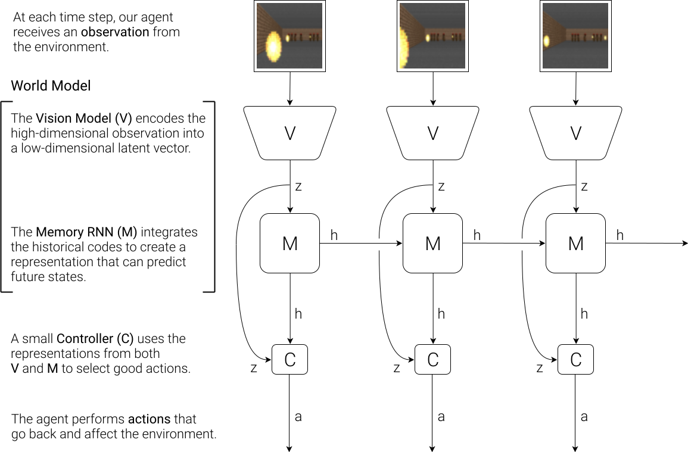</a><figcaption>图 1　World Models 作者论文网页的总体架构图。来源：Ha 与 Schmidhuber，2018。</figcaption></figure>

**顺着箭头读：**观测进入 V，压缩成 z；M 综合 z、动作和历史形成记忆 h，并预测后续潜在状态分布；C 利用 z 和 h 产生动作，再作用于环境。

| 模块 | 输入 | 输出 | 主要职责 |
|---|---|---|---|
| V 即 VAE | 图像 | 潜在表示 z | 压缩空间信息 |
| M 即 MDN-RNN | 潜在状态、动作、递归记忆 | 后续状态的分布与更新记忆 | 学习时序变化及不确定性 |
| C 即 Controller | z 与 h | 动作 | 根据当前信息和历史作决策 |

<figure class="paper-figure"><a href="/assets/world-model-four-routes/wm1.svg">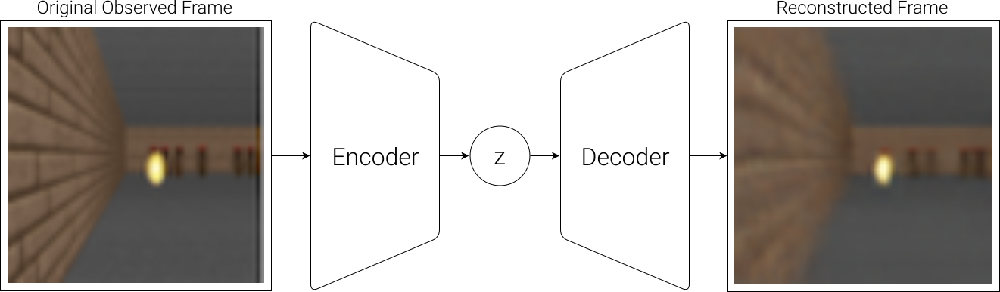</a><figcaption>图 2　原论文网页 VAE 图。左侧编码、右侧重建；重建任务帮助学习压缩表示。</figcaption></figure>

**为什么要重建？**这是训练编码器的一种约束：压缩结果应保留足够的图像信息。这里的 decoder 服务于表征学习，不能因为图上能还原画面，就认为控制器每次决策都必须观看生成图像。

<figure class="paper-figure"><a href="/assets/world-model-four-routes/wm2.svg">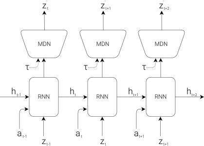</a><figcaption>图 3　原论文网页 MDN-RNN 图。MDN 表示混合密度网络，用分布表达可能的后续状态。</figcaption></figure>

**为什么不能只输入一张图？**教学上可以想象两张位置相同的球：一个向左运动，一个向右运动。单帧相似，未来却不同。历史记忆提供运动信息；概率分布则表达未来可能有多个分支。

**训练与执行分开理解。**原工作先用交互数据学习视觉和动态模块，再优化控制器；经典实验使用进化策略。部分实验在学到的“梦境”中训练控制器，再回到原环境评估。不能把原始 V-M-C 直接描述成后来 Dreamer 的 actor-critic 联合流程。

**架构推论：**模型学会“通常会发生什么”，并不保证在策略主动寻找的极端状态下仍然正确。策略可能找到模型漏洞。因此评估必须回到真实任务环境，而不能只看梦境回报。

### 2.2 Dreamer 的 RSSM 世界模型

Dreamer 把“想象”更系统地用于策略学习。本节以 DreamerV3 的结构为主，不混合各代具体超参数。[DreamerV3 论文](https://arxiv.org/html/2301.04104v2)

<figure class="paper-figure"><a href="/assets/world-model-four-routes/dreamer0.png">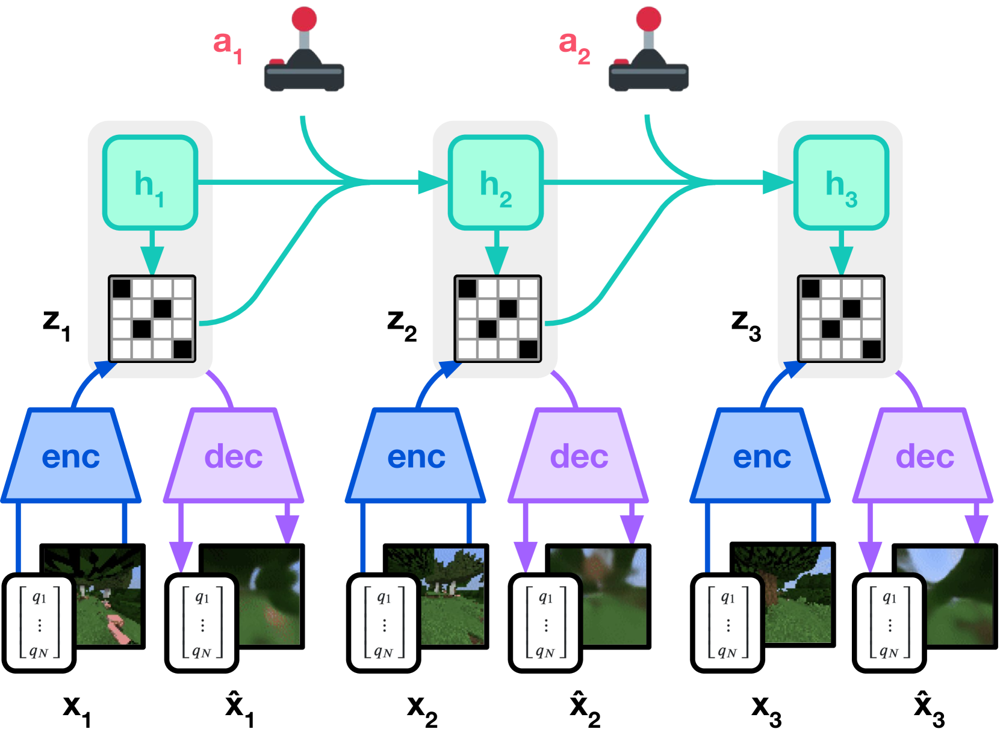</a><figcaption>图 4　DreamerV3 论文 Figure 3a，世界模型学习。</figcaption></figure>

**读图顺序：**从底部真实观测 x 向上读，encoder 提取观测信息；h 表示递归记忆，z 表示随机潜在状态；动作影响下一步动态；decoder 重建观测。完整世界模型还具有奖励、继续状态等预测头，图中只呈现理解核心路径所需的部分。

RSSM 是循环状态空间模型。可以用以下简化关系辅助阅读，具体下标与论文实现可能不同：

```text
hₜ = f(hₜ₋₁, zₜ₋₁, aₜ₋₁)      更新确定性历史
zₜ ~ posterior(hₜ, E(oₜ))        有真实观测时推断状态
ẑₜ ~ prior(hₜ)                  没有未来观测时预测状态
```

**后验与先验是读懂 Dreamer 的关键。**训练时有真实视频，后验能利用当前观测校正状态；想象未来时没有未来观测，只能使用先验。训练需要让两者相容，否则模型在“看着答案”时表现好，独自推演却失效。

### 2.3 Dreamer 如何在想象中训练 actor 和 critic

<figure class="paper-figure"><a href="/assets/world-model-four-routes/dreamer1.png">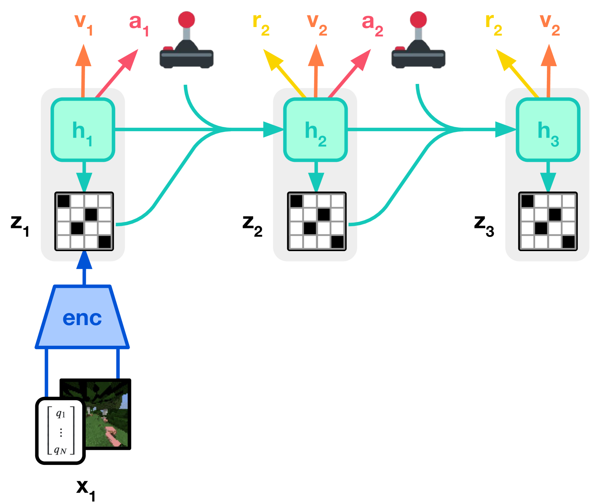</a><figcaption>图 5　DreamerV3 论文 Figure 3b，Actor Critic Learning。</figcaption></figure>

图 4 每一步都有真实输入；图 5 从真实观测建立起点后，后续沿着模型预测展开。actor 输出动作，世界模型产生后续状态与奖励预测，critic 估计未来回报。由此改进策略，再收集新的真实经验。

```text
真实轨迹 → 更新世界模型
真实状态起点 → 想象轨迹 → 更新 actor / critic
更新后的 actor → 真实环境 → 更多轨迹
```

**容易混淆：**“训练时想象未来”不等于“部署时每一个动作都搜索很多候选未来”。Dreamer 的常见执行路径是更新内部状态后调用学好的 actor；它不同于下面 V-JEPA 2-AC 的在线动作优化。

### 2.4 从 Dreamer 到 DayDreamer

DayDreamer 将这类方法应用到真实机器人。论文报告四足机器人约一小时学会翻身、站立和行走的实验。[DayDreamer 原论文](https://arxiv.org/abs/2206.14176)

这个案例说明模型内部学习可以减少昂贵的实际交互，但“一小时”对应具体设备、任务、传感器及实验设置。它不代表不需要真实数据，也不能外推为通用操作任务的时间承诺。

**路线分析：**适合关注交互效率、具有明确奖励反馈的任务。主要瓶颈来自模型误差、探索覆盖和奖励是否与目标一致。架构越强，不代表任务定义的问题会自动消失。

## 3 路线二 在表征空间预测

### 3.1 I-JEPA 是理解 JEPA 的入口

I-JEPA 是图像自监督表征学习方法，不能单独当成完整的机器人动作世界模型。它展示了 JEPA 的关键结构。[I-JEPA 原论文](https://arxiv.org/html/2301.08243v3)

<figure class="paper-figure"><a href="/assets/world-model-four-routes/ijepa0.png">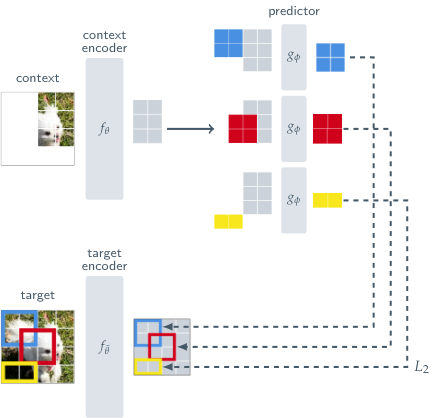</a><figcaption>图 6　I-JEPA 论文 Figure 3。</figcaption></figure>

**顺着两条分支读：**上方 context encoder 编码可见区域；predictor 结合位置标记，预测目标区域特征。下方 target encoder 产生学习目标。两路在特征空间比较，不要求上方输出完整像素图。

| 部分 | 作用 | 不能误解为 |
|---|---|---|
| Context encoder | 从可见内容提取信息 | 看到了完整答案 |
| Predictor | 根据上下文及目标位置预测特征 | 像素级图像解码器 |
| Target encoder | 提供稳定变化的目标表征 | 由同一误差直接任意更新的普通分支 |
| EMA | 用上下文编码器参数的滑动平均更新目标编码器 | 保证理解物理的充分条件 |

stop-gradient 表示目标分支不通过当前预测误差反向更新。EMA、预测器和掩码策略共同参与学习设计，不能把防止表征坍缩的效果全部归结为某一个标签。

<figure class="paper-figure"><a href="/assets/world-model-four-routes/ijepa1.png">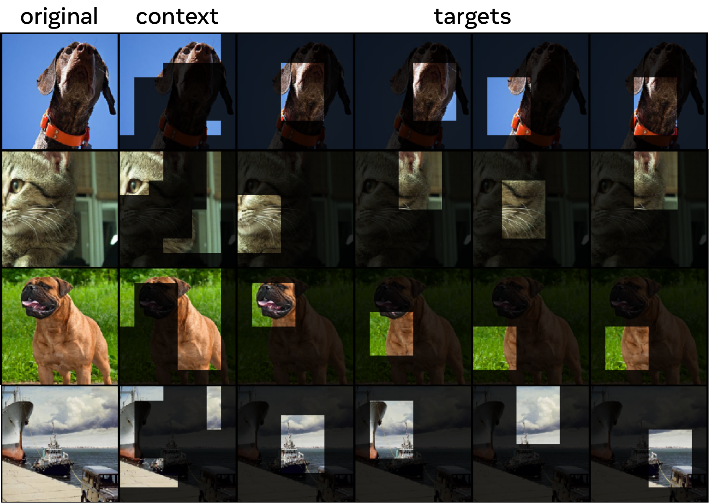</a><figcaption>图 7　I-JEPA 论文 Figure 4，上下文与目标块的抽样示例。</figcaption></figure>

**图 7 要看什么？**目标是有一定面积的块，不能简单靠临近像素复制完成；上下文需要包含足够信息，同时与目标区域区分。掩码不是装饰，它改变了模型必须解决的问题。

**教学理解：**看到动物的头和躯干，推断被挡住部分的结构，比恢复每根毛的颜色更接近这条路线的取向。但“预测抽象信息”仍需要训练验证，不能预设网络已经学到人类想要的全部语义。

### 3.2 V-JEPA 2 的视频预训练

<figure class="paper-figure"><a href="/assets/world-model-four-routes/vjepa0.png">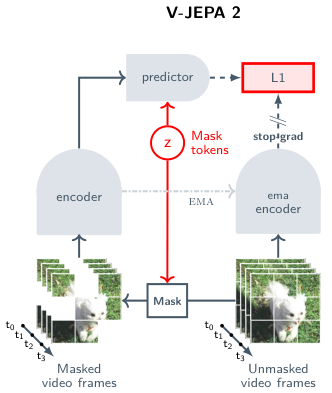</a><figcaption>图 8　V-JEPA 2 论文 Figure 2 左侧，视频表征预训练。<a href="https://arxiv.org/html/2506.09985v1">原论文</a></figcaption></figure>

把图片 patch 扩展到视频时空 token，就可以通过可见部分预测被遮挡部分的表征。图中的 Mask tokens 告诉 predictor 需要预测的位置；目标分支编码未遮挡视频，提供特征监督。

**与一般未来预测的区别：**掩码预测未必只遮住时间上尚未发生的未来，也可能是时空区域。学到良好视频表征与学到动作条件状态转移，是相关但不同的训练问题。

### 3.3 V-JEPA 2-AC 怎样加入动作

<figure class="paper-figure"><a href="/assets/world-model-four-routes/vjepa1.png">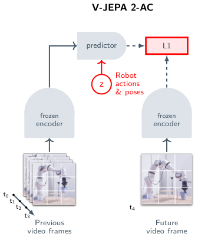</a><figcaption>图 9　同论文 Figure 2 右侧，V-JEPA 2-AC。AC 表示 action-conditioned。</figcaption></figure>

图 8 的预训练与图 9 的机器人训练应分开看。AC 阶段冻结视觉编码器，训练接收机器人动作及位姿信息的预测器，预测后续视觉特征。这让模型能够回答“采取不同动作，未来特征会怎样变化”。

<figure class="paper-figure"><a href="/assets/world-model-four-routes/vjepa2.png">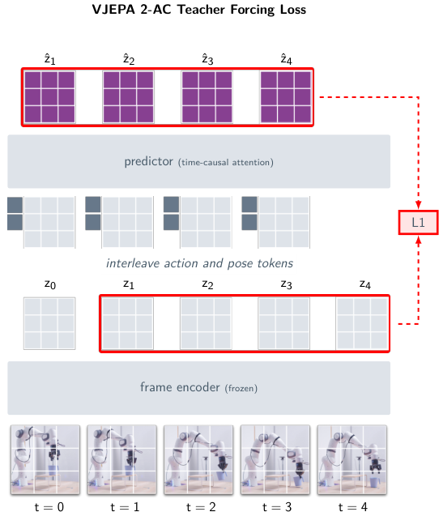</a><figcaption>图 10　同论文 Figure 6 左侧，teacher forcing 训练。</figcaption></figure>

<figure class="paper-figure"><a href="/assets/world-model-four-routes/vjepa3.png">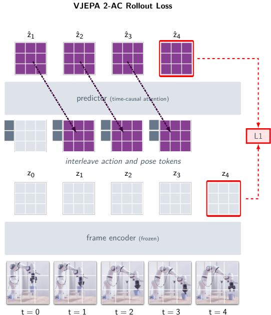</a><figcaption>图 11　同论文 Figure 6 右侧，rollout 训练。</figcaption></figure>

**对照图 10 和图 11：**前者每一步接入真实状态的编码；后者将先前预测再次作为输入，练习连续推演。后一种训练使模型面对更接近部署时的输入分布。二者帮助控制误差累积，但不是消除一切长期误差的证明。

### 3.4 V-JEPA 2-AC 怎样选动作

<figure class="paper-figure"><a href="/assets/world-model-four-routes/vjepa4.png">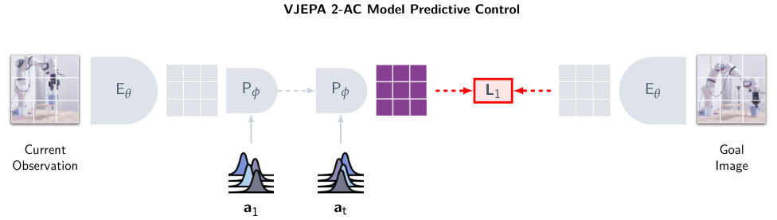</a><figcaption>图 12　同论文 Figure 7，模型预测控制。</figcaption></figure>

图右侧目标图像被编码成目标特征；左侧当前状态沿候选动作向前推演。系统比较预测末端特征与目标特征的距离，通过交叉熵方法 CEM 优化动作序列，执行一部分后重新观察、重新规划。

```text
编码当前图像与目标图像
→ 采样候选动作序列
→ 预测各自的未来特征
→ 用目标距离排序，更新采样分布
→ 执行动作，重新观察
```

**不要混淆两个“交叉熵”。**这里的 CEM 是一种基于采样与精英筛选的优化方法，不是说规划器在做分类交叉熵训练。

### 3.5 这条路线的关键取舍

**分析：**减少对像素细节的建模要求，可以把学习重点转向更稳定的结构；但任务依赖的细节如果在编码时丢失，规划器之后难以恢复。比如杯子姿态差异很小，可能决定是否会洒水；视觉相似也可能掩盖接触状态不同。

因此要问：目标特征距离是否真的反映任务完成？动作变化能否在表征中被区分？相机位置改变后，距离度量是否仍然可靠？这比单纯说“隐空间更高效”更能判断系统是否可用。

## 4 路线三 用视频生成模型构建世界先验

### 4.1 Cosmos 是模型平台而非单一网络

本节以 Cosmos 初始技术报告和 Cosmos-Transfer1 为例。原始 Cosmos 包含连续潜变量上的扩散模型、离散 token 上的自回归模型、视频 tokenizer，以及数据处理和后训练流程。[Cosmos 技术报告](https://arxiv.org/html/2501.03575v1)

**结构概括：**视频先压缩成 token，生成主干学习这些 token 的变化，再解码成视频。机器人或驾驶任务需要额外条件、适配和验证，不能把基础视频生成能力直接等同于机器人控制能力。

### 4.2 Tokenizer 把视频变成可计算的表示

<figure class="paper-figure"><a href="/assets/world-model-four-routes/cosmos0.png">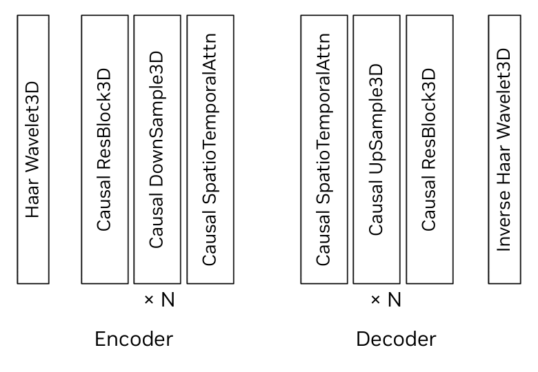</a><figcaption>图 13　Cosmos 技术报告 Figure 9b，Tokenizer 编码器与解码器结构。</figcaption></figure>

从左向右看 encoder：小波变换、因果残差、下采样、时空注意力逐步处理视频；decoder 通过相应的上采样和逆变换恢复视频。它不是“理解指令并出动作”的模块，而是视频表示与重建基础。

<figure class="paper-figure"><a href="/assets/world-model-four-routes/cosmos1.png">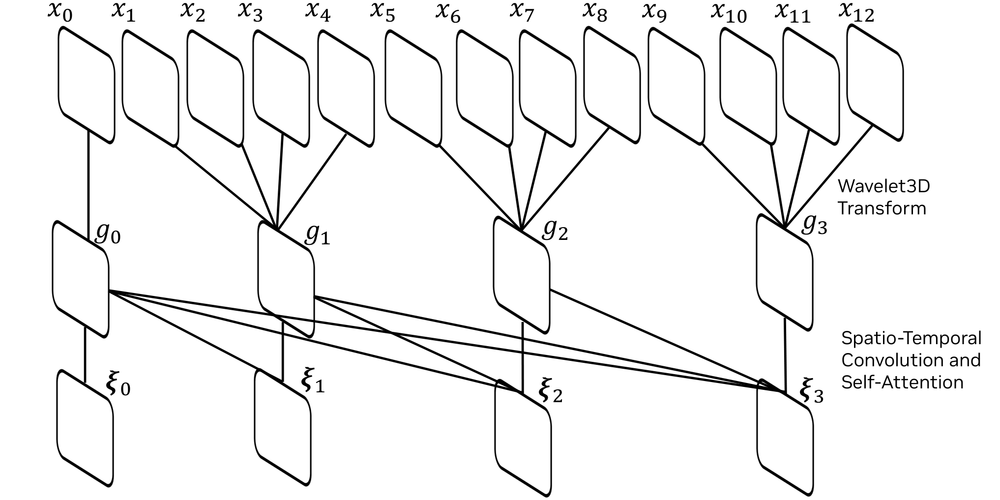</a><figcaption>图 14　同报告 Figure 9a，时间因果结构。</figcaption></figure>

**因果在这里是什么意思？**主要是计算依赖受到时间方向限制，避免表示通过不允许的路径访问未来。这与证明模型理解了真实世界因果规律不是一回事。

### 4.3 两类生成主干怎样区别

| 维度 | 扩散或流匹配式生成的理解 | 离散自回归生成的理解 |
|---|---|---|
| 表示 | 连续潜变量 | 离散 token |
| 核心任务 | 从噪声逐步恢复或传输到数据分布 | 根据已有 token 预测后续 token |
| 计算过程 | 多个去噪或积分步骤 | 按生成顺序不断延长序列 |
| 常见条件 | 文本、已有视频、其他控制输入 | 已有 token 与条件信息 |
| 主要代价 | 迭代生成成本 | 长序列生成成本 |

这是理解两类机制的教学比较，不表示所有后续 Cosmos 版本都完全沿用相同结构。“自回归”和“扩散”也不是互斥的：可以跨时间自回归，而每个时间块内部用扩散生成，WAM 就会出现这种组合。

### 4.4 Cosmos-Transfer1 如何注入结构控制

<figure class="paper-figure"><a href="/assets/world-model-four-routes/transfer_arch.svg">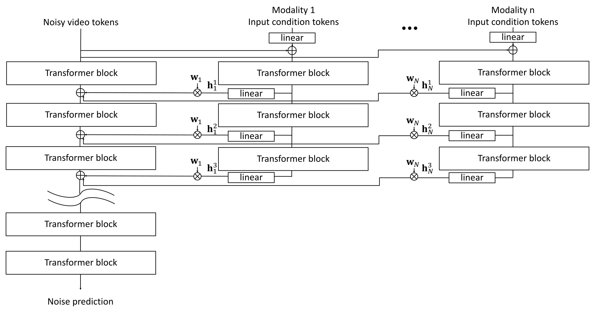</a><figcaption>图 15　Cosmos-Transfer1 论文 Figure 2，多模态控制分支。<a href="https://arxiv.org/html/2503.14492v1">原论文</a></figcaption></figure>

主干负责生成，各控制分支提取深度、分割、边缘等条件。不同分支的特征经过时空权重图加权，再注入主干。论文分别训练控制分支，并在推理时组合它们。

<figure class="paper-figure"><a href="/assets/world-model-four-routes/transfer0.png">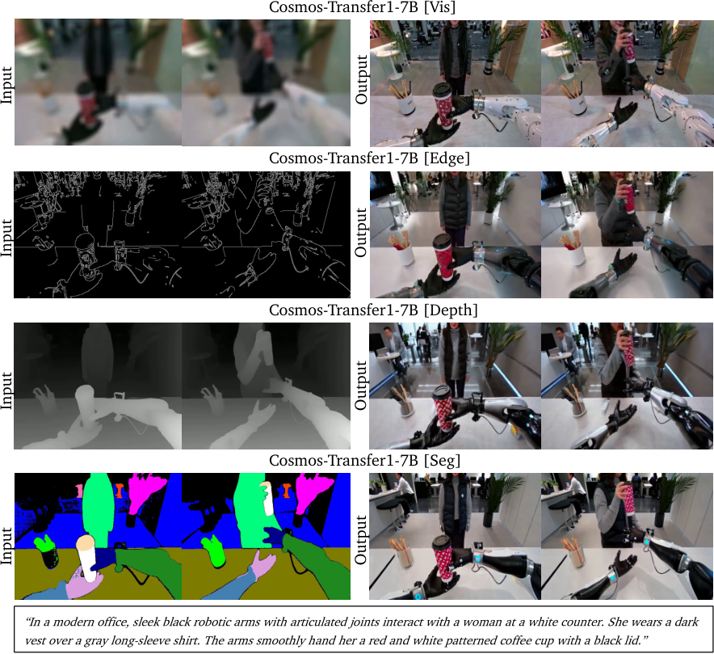</a><figcaption>图 16　同论文 Figure 3，不同条件保留的内容不同。</figcaption></figure>

| 控制信息 | 希望约束的内容 | 教学例子 |
|---|---|---|
| Vis 视觉输入 | 外观与总体构图 | 尽量保持衣服颜色 |
| Edge 边缘 | 物体轮廓 | 保持工具和手的边界 |
| Depth 深度 | 空间几何 | 改纹理时保持前后关系 |
| Seg 分割 | 区域类别与布局 | 维持人、桌子、背景的分区 |

<figure class="paper-figure"><a href="/assets/world-model-four-routes/transfer1.png">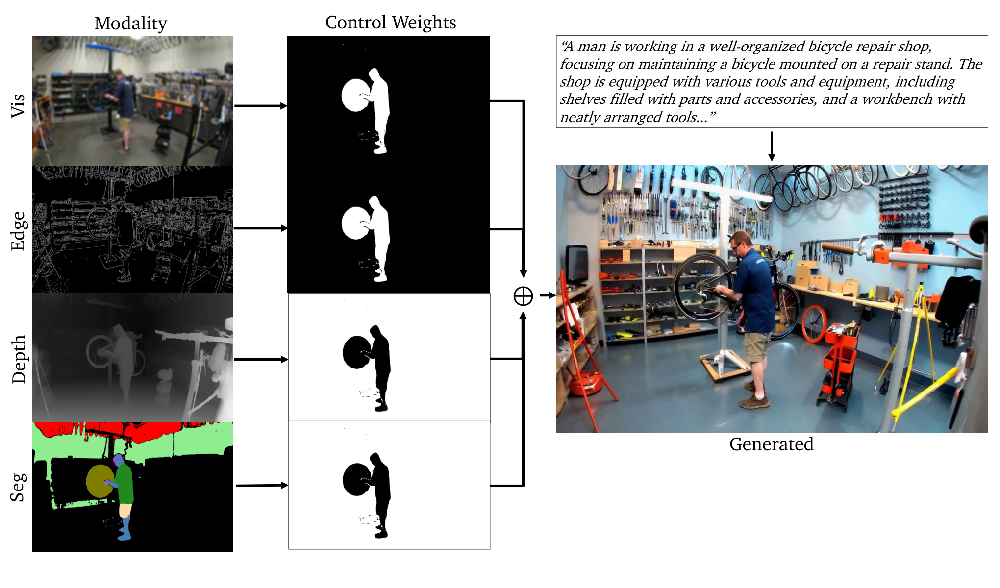</a><figcaption>图 17　同论文 Figure 6，不同区域使用不同控制权重。</figcaption></figure>

图 17 的要点是“在哪里相信哪类条件”。前景可优先保留人物和操作边界，背景则允许更多外观变化。权重图本身也需要来源：可以人工设计或采用规则等方式，不能假设系统天然知道最优权重。

### 4.5 生成视频为什么不等于可靠模拟器

**分析：**模拟器用于控制，需要对动作有可验证响应，还需要持续状态、交互接口、任务反馈与重置方式。一个视频看起来像抓取成功，不代表真实夹爪接触力足够，也不代表输出动作在机器人上可执行。

视频生成最直接的价值之一是改变视觉条件、扩充数据覆盖。验收时应检查几何、动作标签和时间对齐有没有被破坏，再看真实任务是否改善。把“生成视频很多”当成“训练数据有效很多”，会掩盖系统性误差。

## 5 路线四 联合建模未来世界和动作

### 5.1 从 VLA 到 WAM 应看训练目标

VLA 通常强调视觉、语言条件下的动作预测；本笔记中的 WAM 明确加入未来视觉变化的建模。不能据此断言所有 VLA 都没有记忆、没有动态知识，或一定无法泛化。实际模型边界会重叠。

理解 WAM 时抓住三个问题：视频和动作如何交互？生成过程中哪些信息来自真实观察？耗时的预测怎样与正在运动的机器人协调？

### 5.2 DreamZero 的统一视频动作模型

<figure class="paper-figure"><a href="/assets/world-model-four-routes/dreamzero0.png">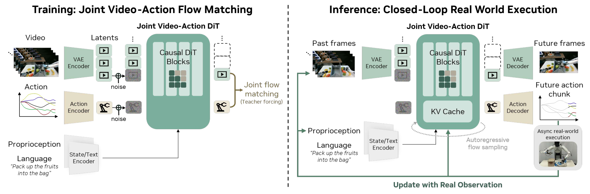</a><figcaption>图 18　DreamZero 论文 Figure 4，左侧训练，右侧闭环执行。<a href="https://arxiv.org/html/2602.15922v1">原论文</a></figcaption></figure>

**左侧数据流：**视频经过 VAE 编码，动作经过动作编码，语言和本体状态提供条件。模型对带噪视频潜变量和动作进行联合 flow matching，分别输出视频与动作。历史块作为干净上下文，当前块学习恢复目标。

**右侧执行流：**根据当前真实观测和历史缓存生成下一块视频、动作；机器人执行动作；新的真实观测进入 KV cache，替换相应预测信息，避免一直把自己想象的画面当作现实。

**架构重点：**DreamZero 用统一模型端到端训练视频和动作目标。它不是把一个现成视频生成器和一个完全独立的逆动力学网络简单串联。论文对视频模态采用自回归历史设计，不能把图中的“自回归”理解成所有模态都采用完全相同的注意力关系。

<figure class="paper-figure"><a href="/assets/world-model-four-routes/dreamzero1.png">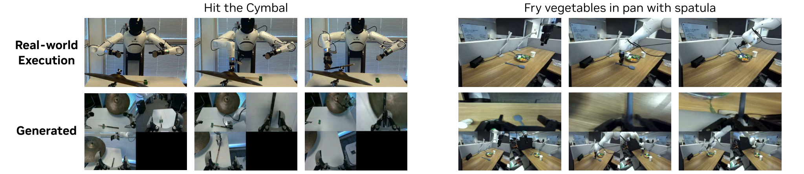</a><figcaption>图 19　同论文 Figure 2，真实执行与生成视频的对照示例。</figcaption></figure>

**图 19 的正确用途：**观察视觉预测与动作执行是否一致，帮助理解联合目标。少量可视化案例不能证明物理规律已被完整掌握，也不能替代成功率和失败分析。

### 5.3 Flow matching 为什么能输出连续动作

以下是教学化解释，不限定某一论文的全部实现细节。设目标动作向量为 y，噪声为 ε：

```text
yτ = (1 − τ) ε + τ y
目标方向 = y − ε
模型学习：在给定条件和 τ 时，怎样沿向量场移动
推理：从噪声出发，若干步积分得到动作样本
```

同样的思想可以用于视频潜变量。动作无需先变成自然语言，再解析成电机命令；它可以作为连续向量直接进入生成过程。真正部署时仍需动作归一化、单位、坐标系和控制接口匹配。

### 5.4 LingBot-VA 的双流与交错建模

<figure class="paper-figure"><a href="/assets/world-model-four-routes/lingbot0.png">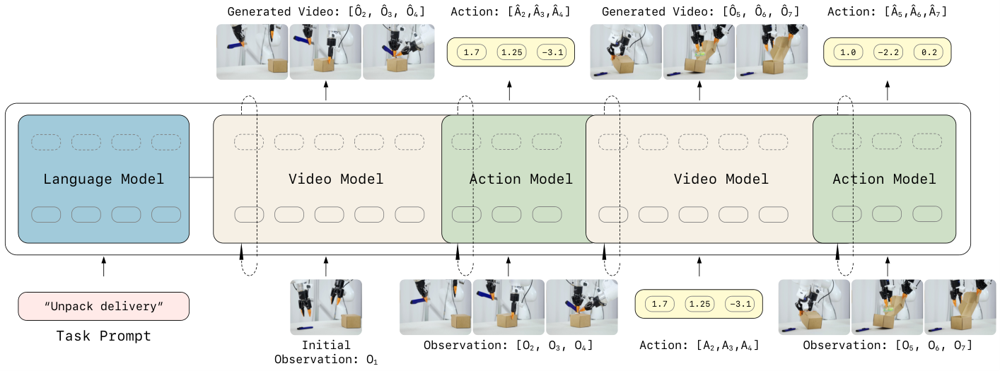</a><figcaption>图 20　LingBot-VA 论文 Figure 2。<a href="https://arxiv.org/html/2601.21998v1">原论文</a></figcaption></figure>

视频流与动作流通过双流 Mixture-of-Transformers 结构交互，在统一时间序列中交错处理。论文图示强调：先预测未来视觉状态，再根据视觉状态转移推断对应动作；整体又在统一框架中训练并共享注意力信息。

**不要走向两个极端。**它既不宜被描述成完全没有视频—动作分工，也不宜被描述成两个毫无交互、独立训练的模型。概念上有动态预测与逆动力学分工，架构上有紧密耦合。

**MoT 与 MoE 的区别：**这里关注不同模态的 Transformer 流及其注意力交互，不应只因有“Mixture”就想象成语言模型里常见的稀疏路由专家结构。

### 5.5 LingBot-VA 为什么需要异步执行

<figure class="paper-figure"><a href="/assets/world-model-four-routes/lingbot1.png">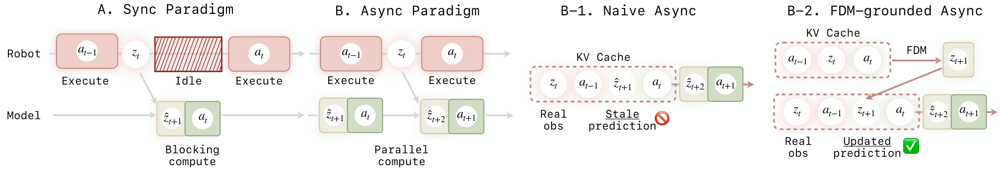</a><figcaption>图 21　同论文 Figure 4，同步、朴素异步与结合前向动态更新的异步方案。</figcaption></figure>

同步系统在等待推理时可能停顿。异步让机器人执行当前动作，同时计算后续动作；但这会产生“输入已经过时”的问题。图中后者利用最近真实观察更新预测，处理朴素异步中的陈旧视觉信息。

论文还研究用带噪历史增强训练，使动作推断可利用尚未完全去噪的视觉表示。理解上，机器人有时需要的是足以决定动作的视觉结构，而非每一处像素都完成精修。这是计算量与动作质量之间的取舍。

### 5.6 DreamZero 与 LingBot-VA 的比较

| 问题 | DreamZero | LingBot-VA |
|---|---|---|
| 共同基础 | 视频生成先验和动作学习结合 | 视频生成先验和动作学习结合 |
| 架构重点 | 统一主干中的视频动作联合生成 | 视频与动作双流、交错处理及逆动力学条件 |
| 训练阅读重点 | 当前块联合 flow matching，历史上下文 | 双模态交互、时序因果关系、带噪历史 |
| 执行阅读重点 | 真实观察更新缓存、异步执行 | 异步流水线与陈旧预测更新 |
| 不能直接推出的结论 | 任意机器人上无需适配 | 因果掩码等于掌握真实因果规律 |

**分析：**二者把动作输出拉近世界预测，但仍受制于机器人数据、运动学、接触感知和计算时延。模型能生成动作，不等于动作已被低层控制器正确执行；世界预测也不能替代底层闭环控制。

## 6 用同一个任务贯穿四条路线

以下是为理解机制构造的例子，不是四篇论文在统一基准上的实验结果。任务：把桌上的杯子移到指定区域。

| 路线 | 学习阶段 | 执行阶段 | 最需要检验 |
|---|---|---|---|
| Dreamer | 收集交互并学习动态；在想象中按奖励改进策略 | 更新隐状态，actor 选择动作 | 奖励是否正确、模型漏洞是否被利用 |
| V-JEPA 2-AC | 视频表征预训练；机器人动作条件预测训练 | 对候选动作推演，靠目标图像特征距离规划 | 特征距离是否反映杯子真实到位 |
| Cosmos / Transfer | 学视频生成与条件变换；为任务制作或扩充数据 | 需配合额外策略或控制系统 | 生成数据是否保持正确几何和标签 |
| WAM | 联合学习未来视觉变化及动作 | 生成动作块，执行并接收真实观察 | 视觉预测与动作是否一致、反馈是否及时 |

这张表揭示一个实用差别：**环境模型可能是训练工具、在线规划工具、数据生产工具，也可能是策略的一部分。**看到“world model”这个名字时，先确认它在系统里扮演哪种角色。

## 7 常见问题与容易误读的地方

### 7.1 世界模型必须生成视频吗

不必须。潜在状态和抽象特征也可以表达环境变化。可视化便于人理解，但并不是判定世界模型的唯一标准。

### 7.2 在隐空间预测就是 JEPA 吗

不是。Dreamer 的 RSSM 也在隐空间预测，但有不同的状态建模、重建、奖励和策略学习设计。应看目标函数与决策接口，不只看有没有 z。

### 7.3 JEPA 不重建像素 是否意味着不用视觉细节

不意味着。它改变监督目标，模型仍可能保留细节。是否保留了任务需要的细节，必须在下游任务中检查，不能由名称推断。

### 7.4 自回归与扩散为什么可以同时存在

两个词可以描述不同轴。跨环境时间按块生成是自回归；每个块内部从噪声到样本的迭代是扩散或流匹配式生成。应把时间轴 t 和噪声轴 τ 分开画。

### 7.5 teacher forcing 为什么会产生训练执行差异

训练时历史输入可能是真实数据；执行时历史可能包含模型自己的预测。后者误差会改变后续输入。rollout 训练、带噪历史以及真实观察反馈，是应对这一差异的不同手段。

### 7.6 KV cache 保存了什么

保存注意力机制可复用的键和值，降低重复计算并保留历史上下文。它不是数据库式的绝对真实世界状态；若缓存基于错误预测，仍可能持续传播错误。

### 7.7 动作块为什么既有用又有风险

一次输出多个未来动作，能分摊推理开销并保持局部运动连贯。但执行越久才更新，越难及时响应抓空、物体移动等变化。块长是效率与反应速度的折中。

### 7.8 零样本控制是否等于没有训练

不是。需要明确“零”的对象：未见任务、未见物体、未见环境，还是全新机器人。预训练数据、机器人动作数据、硬件标定和目标接口仍可能存在。

### 7.9 能预测画面 是否意味着学到因果规律

不充分。视频中的相关性、网络中的因果掩码、真实干预因果关系是不同概念。要考查改变动作后模型是否预测正确，以及不熟悉场景中的响应是否可靠。

### 7.10 哪条路线更好

这个问题缺少任务与预算条件。若关心真实试错成本，考查模型强化学习；若关心表征与目标规划，考查 JEPA；若关心场景多样性，考查视频生成；若关心通用动作输出，考查 WAM。真正比较还要控制数据、算力、设备和评价协议。

## 8 一张模型架构复习表

| 模型 | 必记模块 | 学习目标 | 行动接口 | 最易混淆处 |
|---|---|---|---|---|
| World Models | VAE、MDN-RNN、Controller | 重建、动态分布、控制回报 | 小型控制器 | 与 Dreamer 的训练方式混为一谈 |
| Dreamer | RSSM、预测头、actor、critic | 世界模型学习 + 想象回报优化 | actor | 以为执行时必须在线搜索 |
| I-JEPA | context、target、predictor、EMA | 目标块表征预测 | 本身无机器人控制接口 | 把图像表征学习当完整控制系统 |
| V-JEPA 2-AC | 冻结编码器、动作条件预测器、CEM | 未来特征及 rollout 预测 | 在线规划 | 忽略动作条件后训练 |
| Cosmos | tokenizer、视频生成主干、decoder | 视频建模 | 需下游适配 | 把生成真实性当物理准确性 |
| Cosmos-Transfer1 | 生成主干、控制分支、时空权重 | 条件视频生成 | 数据和场景变换 | 以为结构控制就是电机控制 |
| DreamZero | 视频 VAE、动作/状态编码器、DiT、缓存 | 联合视频动作 flow matching | 动作块 + 反馈 | 以为视频好看就保证动作正确 |
| LingBot-VA | 视频动作双流 MoT、缓存、异步机制 | 视觉动态与动作共同学习 | 交错生成 + 反馈 | 把双流误作独立串联系统 |

## 9 阅读论文时的检查清单

1. 圈出观测、动作、目标和本体状态，确认每个变量的物理含义。
2. 标出哪些是训练时才有的真值，哪些是执行时可获得的信息。
3. 画出环境时间轴与生成噪声时间轴，避免把二者混为一谈。
4. 找出损失函数施加在哪里：像素、特征、奖励、动作，还是几者组合。
5. 标注冻结、EMA 和直接梯度更新的模块。
6. 找到动作最终由谁决定：actor、优化器、逆动力学，还是联合生成。
7. 检查闭环：新观察何时进入？错误预测何时被替换？
8. 查失败情况、数据预算和测试分布，不只看最成功的视频。

**自测题：**如果删掉图中的 decoder，系统还能执行吗？如果删掉动作输入，模型还能预测干预后果吗？如果没有目标或奖励，系统凭什么知道哪一种未来更好？如果不接收新的真实观察，误差会怎样增长？能回答这四个问题，通常就已经抓住架构的主要逻辑。

## 10 原始资料与图片索引

| 来源 | 本笔记用途 | 原始链接 |
|---|---|---|
| 可lip 一口气看懂世界模型 | 四条路线的主题框架；未取得完整字幕 | [B站视频](https://www.bilibili.com/video/BV1ZdpM6jEi7/) |
| Ha & Schmidhuber 2018 World Models | 图 1–3；V-M-C | [作者论文网页](https://worldmodels.github.io/) |
| Hafner et al. DreamerV3 v2 | 图 4–5；RSSM 与想象策略学习 | [原论文](https://arxiv.org/html/2301.04104v2) |
| Wu et al. DayDreamer 2022 | 真实机器人应用案例 | [原论文](https://arxiv.org/abs/2206.14176) |
| Assran et al. I-JEPA v3 | 图 6–7；联合嵌入预测 | [原论文](https://arxiv.org/html/2301.08243v3) |
| V-JEPA 2 v1 | 图 8–12；预训练 AC 训练及规划 | [原论文](https://arxiv.org/html/2506.09985v1) |
| NVIDIA Cosmos 初始报告 v1 | 图 13–14；视频 tokenizer 与生成主干 | [原报告](https://arxiv.org/html/2501.03575v1) |
| Cosmos-Transfer1 v1 | 图 15–17；多模态控制 | [原论文](https://arxiv.org/html/2503.14492v1) |
| Ye et al. DreamZero v1 | 图 18–19；统一视频动作模型 | [原论文](https://arxiv.org/html/2602.15922v1) |
| Li et al. LingBot-VA v1 | 图 20–21；双流与异步执行 | [原论文](https://arxiv.org/html/2601.21998v1) |

图像版权归原作者或相应权利人所有。图片沿用论文或作者论文网页的原图；图注中的中文是本笔记说明，不是原文逐字翻译。对外再发布时请遵循各原始来源的许可条件。
